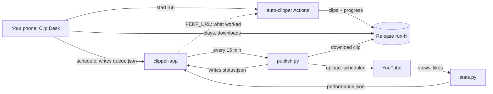

# Clip Desk (clipper-app)

The **phone app and upload scheduler** for [`auto-clipper`](../auto-clipper). One small public repo that gives you:

- **Clip Desk**, a web app for your phone (hosted on GitHub Pages): paste links or topics, start a clipping run, watch live progress, play and download the clips, edit the title, description and tags, and schedule the YouTube upload.
- A **scheduler** (GitHub Actions) that uploads your queued clips to YouTube, scheduled to the exact time you pick.
- A **performance tracker** that records views and likes of your uploads so the AI can learn what works.

> Your clips and keys are never stored in this repo. Only the schedule (titles, descriptions, tags, times) and public video statistics are, and this repo is public.

---

## Contents

1. [How the two repos work together](#how-the-two-repos-work-together)
2. [Repository structure](#repository-structure)
3. [Setup](#setup)
4. [YouTube sign-in setup](#youtube-sign-in-setup)
5. [Secrets](#secrets)
6. [Using the app](#using-the-app)
7. [How scheduling works](#how-scheduling-works)
8. [The performance loop](#the-performance-loop)
9. [Settings in the app](#settings-in-the-app)
10. [Troubleshooting](#troubleshooting)
11. [Privacy and security](#privacy-and-security)
12. [Updating](#updating)
13. [Changelog](#changelog)

---

## How the two repos work together



- **`auto-clipper`** (private) makes the clips and keeps them in GitHub Releases.
- **`clipper-app`** (this repo, public) hosts the app and the scheduler.
- They talk through the GitHub API with **one access key**, which you paste into the app and which stays in your phone's browser only.

---

## Repository structure

```
clipper-app/
├── .github/
│   └── workflows/
│       └── publish.yml        # runs every 15 min: uploads due clips, then updates stats
├── index.html                 # Clip Desk, the phone web app (GitHub Pages)
├── privacy.html               # short privacy page (needed on Google's consent screen)
├── publish.py                 # uploads queued clips to YouTube
├── stats.py                   # collects views/likes into performance.json
├── get_youtube_token.py       # optional helper to create the YouTube refresh token on a computer
├── queue.json                 # the schedule (written by the app)
├── status.json                # upload results (written by publish.py)
├── performance.json           # views and likes (written by stats.py)
└── README.md
```

Notes:

- Only `.github/workflows/publish.yml` is used. If you also uploaded a `publish.yml` at the top level, delete it.
- `queue.json` starts as `[]`, `status.json` as `{}`, `performance.json` as `{"updated_at": null, "videos": []}`.

---

## Setup

### 1. Create the repo and turn on GitHub Pages

1. Create a **public** repo named `clipper-app` and upload all files above (the workflow at `.github/workflows/publish.yml`).
2. *Settings → Pages → Build and deployment → Deploy from a branch → `main` / `/ (root)` → Save.*
3. After about a minute the app is at `https://<your-username>.github.io/clipper-app/`. Open it on your phone and use *Add to home screen* so it opens like an app.
4. *Settings → Actions → General → Workflow permissions → Read and write permissions → Save* (the scheduler commits `status.json`).

### 2. Create the access key (one key for both repos)

*GitHub profile picture → Settings → Developer settings → Personal access tokens → Fine-grained tokens → Generate new token.*

- **Repository access:** *Only select repositories* → `auto-clipper` **and** `clipper-app`.
- **Repository permissions** (one list applies to both repos):

| Permission | Level | Why |
|---|---|---|
| Actions | Read and write | Start runs, cancel runs, trigger the scheduler |
| Contents | **Read and write** | Read clips from releases; write `queue.json` |

- Pick an expiry and note the date. When it expires the app stops working until you make a new key.

Paste the key into the app's **Setup** tab.

### 3. Connect the app

Open **Setup**, check the username, the clipper repo name (`auto-clipper`), the branch (`main`) and the scheduler repo (`<your-username>/clipper-app`), paste the key, tap **Save and test**. It should say it connected to both repos.

### 4. Add the YouTube secrets

See the next two sections.

---

## YouTube sign-in setup

You do this once. It lets the scheduler upload to **your** channel.

### A. Google Cloud project

1. Open the Google Cloud console and create a project (or reuse one).
2. Enable **YouTube Data API v3**.
3. **Google Auth Platform → Branding**: fill in
   - App name (for example `Clipper`), user support email, developer contact email,
   - Application home page: `https://<your-username>.github.io/clipper-app/`
   - Privacy policy link: `https://<your-username>.github.io/clipper-app/privacy.html`
   - Terms link: the home page URL
   - **Authorized domains → Add domain:** `<your-username>.github.io` (domain only, no `https://` and no path)
   - Leave the logo **empty**.
4. **Audience**: user type **External**. Tap **Publish app** so the status is **In production**. If it stays in *Testing*, the sign-in token expires after 7 days.
5. **Clients → Create client → Web application**, add the redirect URI exactly:
   `https://developers.google.com/oauthplayground`
   Save the **Client ID** and **Client secret**.
6. **APIs & Services → Credentials → Create credentials → API key**, restrict it to *YouTube Data API v3*. This is `YT_API_KEY`, used only for reading public view counts.

### B. Refresh token

**Without a computer (OAuth Playground):**

1. Open `developers.google.com/oauthplayground`.
2. Gear icon → tick **Use your own OAuth credentials** → paste the client ID and secret.
3. In the scope box type `https://www.googleapis.com/auth/youtube.upload` → **Authorize APIs**.
4. Sign in with the Google account that owns the YouTube channel. Google shows *"Google hasn't verified this app"*: tap **Advanced → Go to ... (unsafe) → Allow**. This is expected for your own app.
5. **Exchange authorization code for tokens** and copy the **Refresh token** (starts with `1//`).

**With a computer:** `pip install google-auth-oauthlib`, run `python get_youtube_token.py`, enter the client ID and secret, sign in, copy the token it prints. (This route needs a *Desktop app* client.)

> The OAuth Playground shows your client secret and tokens on screen. Don't share screenshots. After setup you can rotate them (new client secret, remove access at myaccount.google.com/permissions, make a new token).

---

## Secrets

*Settings → Secrets and variables → Actions → New repository secret*, in **this repo**:

| Secret | What it is |
|---|---|
| `YT_CLIENT_ID` | OAuth client ID |
| `YT_CLIENT_SECRET` | OAuth client secret |
| `YT_REFRESH_TOKEN` | Refresh token from step B |
| `CLIPPER_READ_TOKEN` | A **separate** fine-grained key: repo `auto-clipper` only, **Contents: Read-only**. Lets the scheduler download clips from the private repo. |
| `YT_API_KEY` | API key restricted to YouTube Data API v3 (view counts) |

The clipper's own secrets (`YT_COOKIES`, AI keys) belong in the `auto-clipper` repo, not here.

---

## Using the app

**Bottom tabs: Clip, Runs, Posts, Setup.**

### Clip

Choose **Specific videos** (paste links, one per line) or **Topics in channels** (topics plus channel links; leave channels empty to search all of YouTube). Open **Clip settings** for the options, then tap **Start clipping**.

Sources: YouTube, Twitch and Kick videos, and direct links to video files (shared Drive or Dropbox). Live streams must have ended.

### Runs

Your recent runs with status, a **live progress bar** and step ("Transcribing 40%", "Editing clip 2 of 5"), a **Cancel** button, and **Open clips** when finished. The list refreshes every 8 seconds while something is running.

**Open clips** shows each clip with its length, game, virality score and reason, what's on screen, which edits were used, and a bar showing where in the source video the clip came from. Buttons: **Play**, **Download**, **Schedule post**.

### Schedule post

A form opens with AI-written drafts that you can edit freely:

- **Title** (100 characters max) with a counter, and **Try another title** to cycle through the AI's 5 options, then templates.
- **Description:** what happens in the clip, a link to the original video at the exact moment, the credit line, and hashtags.
- **Tags:** the AI's tags plus the game and defaults (500 characters total).
- **When:** *As soon as it uploads*, or a date and time on your phone's clock.

Instagram shows as "coming next" (not built).

### Posts

Everything scheduled, with status:

| Status | Meaning |
|---|---|
| Waiting to upload | Queued. Uploads within 15 minutes, or tap **Upload now**. |
| Scheduled on YouTube | Uploaded as private with a publish time. YouTube makes it public at that exact time. |
| Published | Live. Shows an **Open on YouTube** link and views, likes and comments when available. |
| Failed | Shows the reason. **Retry** after fixing it, **Edit**, or **Remove**. |

Removing an already-uploaded post only removes it from this list. Change or delete the video itself in YouTube Studio.

### Setup

Username, clipper repo, branch, scheduler repo and the access key. **Remove key** clears it from the browser.

---

## How scheduling works

1. **Schedule post** writes an item to `queue.json`: `id`, `repo`, `run`, `file`, `title`, `description`, `tags`, `when`, `rev`, and clip details (`meta`).
2. `publish.yml` runs **every 15 minutes** (and when you tap **Upload now** or schedule something).
3. `publish.py` downloads the clip from the release `run-<run>` using `CLIPPER_READ_TOKEN` and uploads it:
   - **Future time:** uploaded as **private** with a `publishAt` time, so YouTube publishes it at the exact minute.
   - **No time, or time already passed:** uploaded as **public** immediately.
   - Category *Gaming*, not made for kids, title, description and tags as you edited them.
4. The result is written to `status.json`. Each item is tried up to **3 times**; editing or tapping **Retry** resets the count.

Things to know:

- YouTube gets the upload within about 15 minutes, but publishes at the exact time you chose.
- The clip must still exist in its release. Releases older than the 10 newest runs are deleted, so schedule soon after clipping.
- Vertical clips under 3 minutes become **Shorts** automatically.
- YouTube's upload quota is far above what you need (about 100 uploads a day).

---

## The performance loop

`stats.py` runs after each scheduler pass but works at most **every 3 hours**. It reads the video IDs from `status.json`, fetches public views, likes and comments with `YT_API_KEY`, and writes `performance.json` (each video's title and clip details, plus its numbers). Videos not yet public are skipped.

In `auto-clipper`, set the variable `PERF_URL` to
`https://raw.githubusercontent.com/<your-username>/clipper-app/main/performance.json`.
Before choosing moments, the AI is shown your best and weakest clips (needs 4+ videos at least a day old). The Posts tab also shows views, likes and comments per upload.

---

## Settings in the app

All are saved in your browser and sent with each run.

| Setting | Choices |
|---|---|
| Video links / Topics / Channels | Links one per line; topics comma-separated |
| How many videos | 1–5 (topics mode) |
| Clips per video | 1–15 |
| Seconds per clip | 10–90 (use **58** for Shorts) |
| Clip length | *Exactly my seconds (up to 59)* or *Let the AI decide, up to my seconds* |
| Vertical layout | **Automatic (recommended)**, Face on top, Blurred whole frame, Follow the face, Center crop |
| Facecam position | Find automatically, top left, top right, bottom left, bottom right, no facecam |
| Source quality | 720p, 1080p, 1440p (output is always 1080×1920) |
| AI moment picking / AI director | On, Off |
| Zoom and slow motion / Cut out silence / Emoji and highlights | On, Off |
| Stock B-roll | Off, Auto |
| Transitions | Off, Fade, Flash, Slide, Wipe, Zoom, Circle, Mix of all |
| Captions / Headline at the start | Word by word, Classic lines, None / Automatic, Off |
| Speech language / Caption quality | Hindi, English, Detect / Fast, Balanced, Best |

The app **remembers old values** in your browser. After updating, open **Clip settings** once and check *Vertical layout* and *Clip length*.

---

## Troubleshooting

| Message or symptom | Cause and fix |
|---|---|
| `Resource not accessible by personal access token` when scheduling | The key lacks permission. Edit it: repositories `auto-clipper` **and** `clipper-app`; **Contents: Read and write**; **Actions: Read and write**. The key itself does not change. |
| `Not found. Check the repo names in Setup` | Wrong username or repo name, or the key doesn't include that repo. Use **Save and test** in Setup. |
| `GitHub rejected the key` | The key expired or was removed. Make a new one and paste it in Setup. |
| `YouTube sign-in failed: Missing required parameter: refresh_token` | The `YT_REFRESH_TOKEN` secret is missing or empty in **this** repo. |
| `YouTube sign-in failed: invalid_grant` | The token expired (a *Testing* app lasts 7 days) or access was removed. Publish the app (*In production*) and create a new refresh token. |
| `Google hasn't verified this app` | Expected. Tap **Advanced → Go to ... (unsafe)**. |
| `Release run-N was not found` | The run is older than the 10 newest releases. Clip it again. |
| Post stays *Waiting to upload* | Tap **Upload now**, then check the **Actions** tab of this repo for the "Publish scheduled clips" run. |
| `uploadLimitExceeded` / quota error | YouTube's daily limit. Try again the next day. |
| A clip won't play in the app | **Play** streams straight from the release link, which works best when the repo is public. With a private clipper repo, use **Download** (opens in a new tab while you're signed in to GitHub) or open the release on GitHub. |
| No progress bar | `auto-clipper`'s workflow needs `statuses: write` and `GITHUB_TOKEN` passed to the clipper step (present in the current `clip.yml`). |
| Open clips says no clips were saved | The run produced none. Open the run's log on GitHub and read `WHY CLIPS WERE NOT MADE`. |
| Times are off | Times use the phone's clock and time zone (shown under the date field). |

---

## Privacy and security

- **Public in this repo:** the schedule (titles, descriptions, tags, times, video IDs) and public statistics. Nothing else.
- **Never here:** clips, cookies, API keys, tokens. Secrets live in GitHub Secrets; the access key lives only in your phone's browser.
- Anyone who gets your access key can start runs and edit your repos. If your phone is lost, delete the key at GitHub (*Developer settings → Fine-grained tokens*).
- Don't share screenshots of the OAuth Playground or the secrets pages. If something leaks, rotate it: new client secret, remove access at `myaccount.google.com/permissions`, new refresh token, then update the secrets.
- Use a **spare** Google account for cookies, and note the access key's expiry date.

---

## Updating

Replace in this repo: `index.html`, `publish.py`, `stats.py`, `.github/workflows/publish.yml`, `privacy.html`, `README.md`. Keep `queue.json`, `status.json` and `performance.json` (they hold your data). Then reload the app on your phone (close and reopen it so the new `index.html` loads).

---

## Changelog

**Latest**
- Automatic layout, facecam position and clip-length settings.
- Live progress bar on running runs.
- AI director output: five title options, a description about the exact moment, tags and the game name fill the schedule form.
- Clip cards show length, game, virality, reason, what's on screen and which edits were used.
- Clips of runs that ended red can still be opened.
- More sources (Twitch, Kick, direct links), transition styles, AI director, zoom, silence cutting and emoji settings.

**Earlier**
- Posts tab with views, likes and comments; performance tracker feeding the AI.
- Scheduling to YouTube at the exact time; edit, retry, remove.
- Phone app to start runs, view runs, play and download clips.
